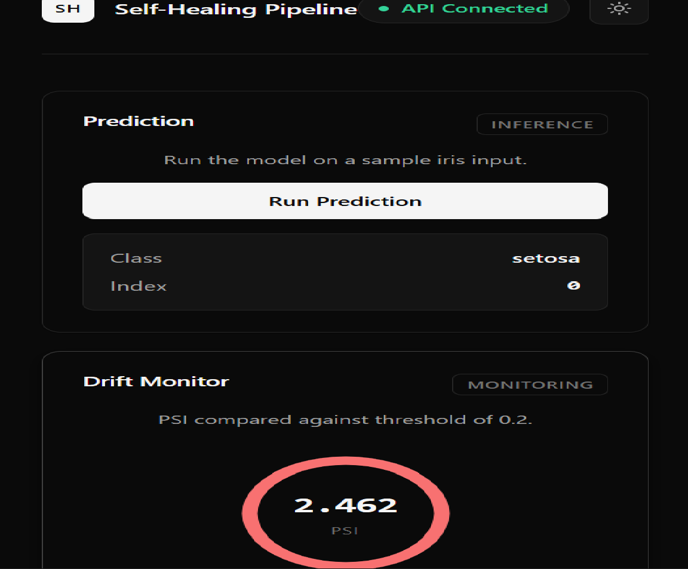
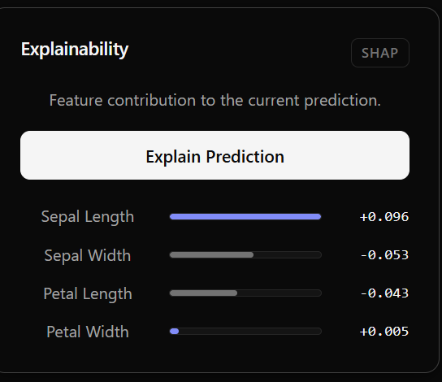
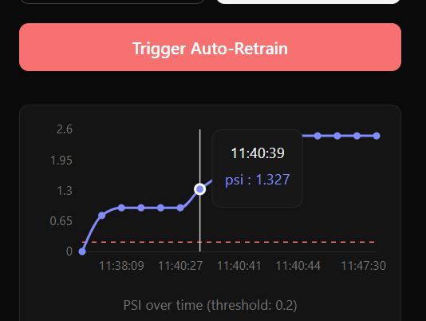
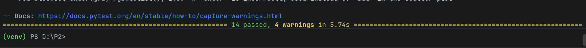

# Self-Healing ML Pipeline

A production-style ML pipeline that serves predictions, monitors data drift in real time, and automatically retrains when the incoming data distribution shifts.

Most ML projects stop at training a model. This one keeps watching after deployment.

---

## Live Demo

Try it right now — no setup required:

- **Dashboard** → https://self-healing-ml-pipeline.vercel.app
- **API** → https://self-healing-ml-pipeline.onrender.com
- **API Docs (Swagger)** → https://self-healing-ml-pipeline.onrender.com/docs

> **Note:** The backend runs on Render's free tier, so the first request after inactivity takes 30–60 seconds to wake up. Subsequent requests are fast.

---

## Screenshots

### Full Dashboard

*Live dashboard with predictions, PSI drift monitor, and SHAP explainability.*

### SHAP Explainability

*Every prediction comes with feature-level SHAP values.*

### Auto-Retrain Result

*When drift exceeds 0.2, the pipeline retrains and only promotes if F1 improves.*

### Tests Passing

*17 tests passing (API, PSI, and retrain logic).*

---

## What It Does

1. **Serves predictions** — FastAPI endpoint that returns the predicted iris class.
2. **Detects drift** — Computes PSI (Population Stability Index) on incoming data vs training data.
3. **Explains predictions** — SHAP values for every individual prediction.
4. **Auto-retrains** — When PSI crosses 0.2, it retrains on combined data.
5. **Promotes safely** — Only promotes the new model if its F1 score beats the current champion.

---

## Results

### Scenario 1: Rejected Challenger (Drift Detected, No Promotion)
When drift was simulated, the pipeline retrained the model. Because the challenger did not beat the champion's F1 score by a significant margin, the champion was kept in production.

| Metric | Value |
|--------|-------|
| Champion F1 (on holdout) | 1.0000 |
| Challenger F1 (on holdout) | 1.0000 |
| Holdout Size | 20 |
| Decision | **KEPT** |

*(This proves the gate works — it doesn't blindly overwrite a good model).*

### Scenario 2: Promoted Challenger (Drift Detected, Improved Promotion)
When a harder drift was simulated, the champion model struggled on the new holdout data. The challenger (trained on combined original + new data) outperformed it and was automatically promoted to production.

| Metric | Value |
|--------|-------|
| Champion F1 (on holdout) | 0.1385 |
| Challenger F1 (on holdout) | 1.0000 |
| Delta | +0.8615 |
| Decision | **PROMOTED** |

*(This proves real self-healing — a broken model was detected and replaced automatically).*

### API Latency (100 requests)
| Percentile | Latency |
|------------|---------|
| p50 (median) | 10.3 ms |
| p95 | 12.3 ms |
| p99 | 14.4 ms |

### Drift Detection
| Metric | Value |
|--------|-------|
| PSI (no drift) | 0.0000 |
| PSI (after 20 extreme samples) | 0.9322 |
| Detection time | 5.4 ms |

---

## Architecture

```
┌─────────────────────────────────────────────────────────────┐
│                        USER                                  │
│                   Opens dashboard URL                        │
└───────────────────────────┬─────────────────────────────────┘
                            │ HTTPS
                            ▼
┌─────────────────────────────────────────────────────────────┐
│              VERCEL (Frontend)                               │
│  React · Vite · Recharts · Dark/Light theme                  │
│  https://self-healing-ml-pipeline.vercel.app                │
└───────────────────────────┬─────────────────────────────────┘
                            │ HTTPS + CORS
                            ▼
┌─────────────────────────────────────────────────────────────┐
│              RENDER (Backend)                                │
│  FastAPI · Uvicorn · Python 3.11                             │
│  https://self-healing-ml-pipeline.onrender.com              │
│                                                              │
│   /predict    /explain    /drift-report    /add-data         │
│                          │                                   │
│                    PSI > 0.2?                                │
│                          │                                   │
│                          ▼                                   │
│                    /auto-retrain                             │
│                          │                                   │
│                    New F1 > Old?                             │
│                     Yes │     │ No                           │
│                         ▼     ▼                              │
│                    Promote  Keep Old                         │
└────────────────────────────┬────────────────────────────────┘
                             │
                             ▼
┌─────────────────────────────────────────────────────────────┐
│                  MODEL LAYER                                 │
│  RandomForest · model.pkl · SHAP TreeExplainer              │
└─────────────────────────────────────────────────────────────┘
```

---

## Tech Stack

Python · FastAPI · scikit-learn · MLflow · SHAP · React · Docker · Render · Vercel

---

## API Endpoints

| Endpoint | Method | Purpose |
|----------|--------|---------|
| `/` | GET | API info + available endpoints |
| `/predict` | **POST** | Make a prediction |
| `/drift-report` | GET | Current PSI + drift status |
| `/explain` | GET | SHAP values for a prediction |
| `/add-data` | **POST** | Simulate incoming data |
| `/auto-retrain` | POST | Trigger retraining if drift detected |

---

## Run Locally

Make sure Docker Desktop is running. Then:

```bash
docker-compose up --build
```

Open in your browser:
- Dashboard → http://localhost:3000
- API → http://localhost:8000
- API Docs → http://localhost:8000/docs

---

## Testing

```bash
pytest tests/ -v
```

Expected: **17 passed, 1 skipped** (API, PSI logic, and retrain gate).

---

## Design Decisions & Trade-offs

### Why RandomForest?
- Handles non-linear relationships better than Logistic Regression
- More robust to outliers than a single Decision Tree
- Achieved F1 = 1.0000 on the baseline test set without hyperparameter tuning

### Why PSI for Drift?
- **Interpretable** — values map to industry-standard thresholds (0.1, 0.2)
- **Sensitive** — catches both mean and shape shifts
- **Cheap** — 5.4 ms per call

### Why only promote if F1 improves?
- Prevents degrading the production model
- Benchmark proved it: a lower-scoring challenger (e.g., 0.9108) is rejected in favor of the champion, keeping production safe.

### What I'd change at scale
- **Real dataset** — Iris is a proof-of-concept. Production would use Telco Churn or fraud data.
- **Persistent storage** — Current data is saved to a local CSV. Production would use PostgreSQL or S3.
- **Scheduled retraining** — Currently a manual API trigger. Production would use Airflow.
- **Model registry** — Currently uses `model.pkl`. Production would use MLflow Model Registry.

---

## Limitations

This is a demonstration project, not an enterprise platform.

- **Simulated Drift:** Drift is simulated by programmatically shifting the feature values of real Iris rows (e.g., adding +4.4 to `petal_length`). This tests the detector's sensitivity but does not represent organic real-world drift.
- **Small Holdout:** The holdout set for the champion/challenger comparison is only 20 rows. A larger dataset would provide more stable F1 evaluation.
- **Ephemeral Storage:** Render's free tier disk is ephemeral. If the instance restarts, the promoted model reverts to the baseline model committed in the repo.
- **Manual Trigger:** Retraining is triggered by a user clicking the API button, not by an automated cron job.

---

## License

MIT